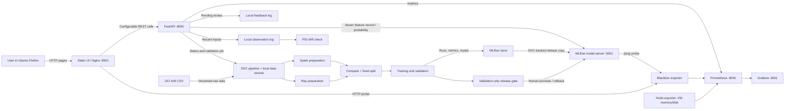

# Smart Maintenance Monitor: architecture

## Purpose and boundary

The application classifies whether one **current** AI4I 2020 synthetic equipment record carries the dataset's machine-failure label. It does not estimate a future failure time or make an autonomous maintenance decision. A human uses the alert as a prompt to inspect a record.

## Block diagram

## What each block does

| Block | Responsibility | Persisted evidence |
| --- | --- | --- |
| Static UI | Six-field form, routine/inspection examples, prediction result, pipeline status and validation console | `ui/`, browser screenshots |
| FastAPI | Validate readings, calculate temperature gap, call MLflow, return recommendation, expose pipeline/job/feedback endpoints and metrics | `api/main.py`, API tests, request logs |
| MLflow serving | Load one released preprocessing-plus-classifier model and return class probabilities | `models/active.dvc`, `models/active_release.json` |
| DVC + Spark/Ray | Validate, prepare independently, compare outputs, and create fixed split IDs | `dvc.yaml`, `dvc.lock`, DVC remote, timing report |
| MLflow tracking | Preserve candidate runs, parameters, metrics, provenance, and model artifacts | `mlflow_store/` VM/Mac state backup |
| Release gate | Reject candidates below validation criteria, switch active artifact on explicit command, and restore previous release | `scripts/release_gate.py`, event history |
| Prometheus + exporters | Scrape API/VM metrics and probe model/UI availability every 10 seconds; evaluate three local alert rules | `monitoring/`, Grafana and targets screenshots |
| Grafana | Display availability, requests, predictions, latency, validation jobs, VM memory and disk | Provisioned dashboard JSON |
| Drift check | Compare recent inputs with fixed training distribution; mark deliberate demo shift separately | `scripts/drift_check.py`, drift report |

The online request path is UI → FastAPI → MLflow model. Spark, Ray, and training are offline jobs; none run per user request. Docker Compose keeps the UI, API, and model as independent services. The UI calls only the API through a configurable URL in `ui/config.js`. The API's model URL is an environment setting. All published ports bind to VM localhost. The API's local DVC and feedback mounts are a course-demo convenience; this is not a production multi-user deployment.

## Deployment and recovery

Ubuntu 26.04 ARM64 UTM VM, 4 vCPUs, 3.3 GiB RAM, 39 GiB root disk. Spark and Ray run sequentially. The seven lightweight serving/monitoring containers can run together; Kubernetes/KServe was not started on this VM. `docker compose down` stops containers without deleting tagged images, DVC data, MLflow runs, or the Prometheus volume. Git history, the DVC remote, and the MLflow store have separate Mac backups. See `docs/resume_after_vm_shutdown.md` for restart steps.
